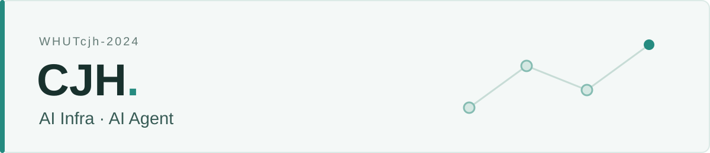

<picture>
  <source media="(max-width: 600px) and (prefers-color-scheme: dark)" srcset="./assets/header-mobile-dark.svg" />
  <source media="(max-width: 600px)" srcset="./assets/header-mobile-light.svg" />
  <source media="(prefers-color-scheme: dark)" srcset="./assets/header-dark.svg" />
  
</picture>

关注 **AI Infra** 与 **AI Agent**：从推理系统的效率，到 Agent 在真实任务中的可靠性。

`Inference` · `CUDA` · `Triton` · `vLLM` · `RAG`

## Projects & Notes

- **[WeKnora](https://github.com/Tencent/WeKnora)** — 参与知识库与 Agent 平台开发，贡献数据源接入、文档处理及沙箱相关改进。 [PRs](https://github.com/Tencent/WeKnora/pulls?q=author%3AWHUTcjh-2024)
- **[RAG-agent](https://github.com/WHUTcjh-2024/RAG-agent)** — 面向服装购买决策的 AI Agent，实践混合检索、工具调用与偏好记忆。
- **[attention_chen](https://github.com/WHUTcjh-2024/attention_chen)** — Attention 与 LLM 推理学习笔记，覆盖 Prefill、Decode 和 KV Cache。 [在线阅读](https://whutcjh-2024.github.io/attention_chen/)

## GitHub Activity

