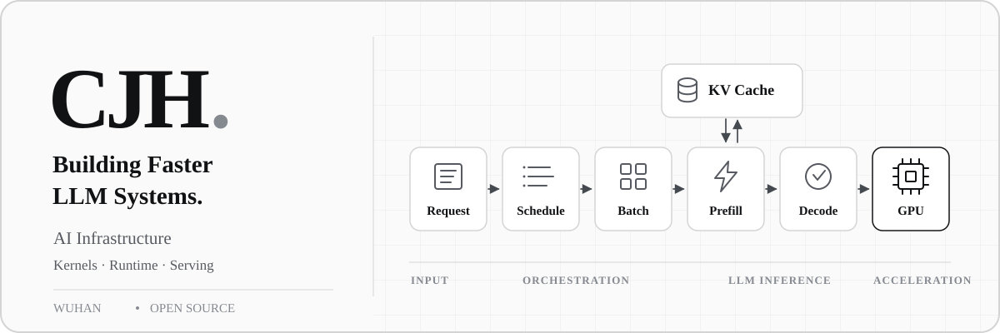

<picture>
  <source media="(max-width: 600px) and (prefers-color-scheme: dark)" srcset="./assets/banner-mono-mobile-dark.svg" />
  <source media="(max-width: 600px)" srcset="./assets/banner-mono-mobile-light.svg" />
  <source media="(prefers-color-scheme: dark)" srcset="./assets/banner-mono-dark.svg" />
  
</picture>

关注推理系统的效率，算子开发与优化，以及 AI Agent 在真实任务中的可靠性。

`Python` · `CUDA` · `Go` · `Linux` · `Triton`

## 工程记录

- 腾讯[WeKnora](https://github.com/Tencent/WeKnora) — 参与开源知识库与 Agent 平台开发，涉及数据源、文档与sandbox。
- 武汉理工大学外国语学院智能语料检索平台开发者（仓库已设为Private），涉及后端开发、语料库检索、自然语言处理。
- **[RAG-agent](https://github.com/WHUTcjh-2024/RAG-agent)** — 面向服装购买决策的 AI Agent，实践混合检索、工具调用与偏好记忆。
- **[attention_chen](https://github.com/WHUTcjh-2024/attention_chen)** — Attention 笔记，记录入门 AI Infra 的过程，正在持续更新中。链接为 https://whutcjh-2024.github.io/attention_chen/
